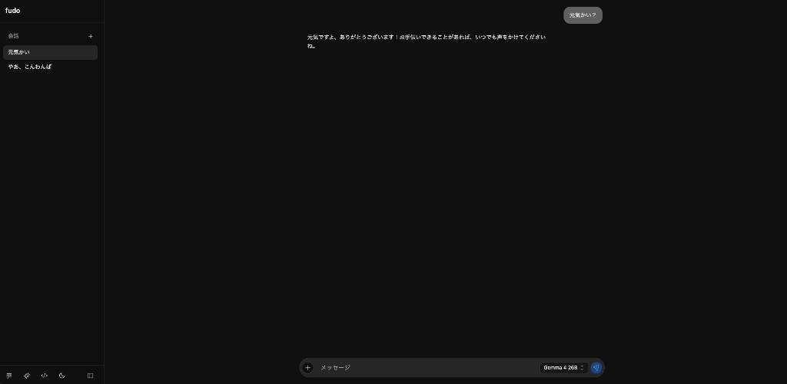
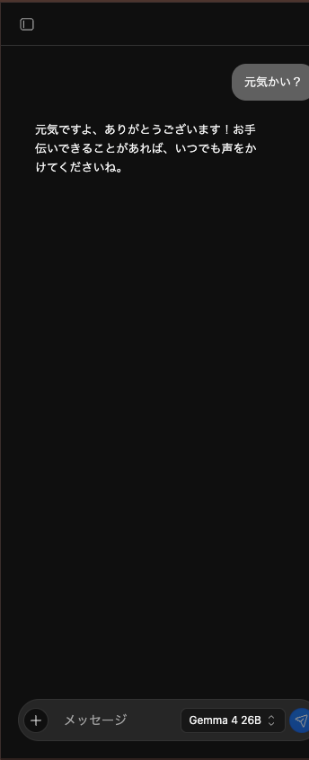

# Chat-based Agent Foundation

対話、承認、カンバン、スキル、ワークフロー、BrowserUse、MCP を持つエージェントの殻です。不動産の計算や台帳は入っていません。

初めて配備する人は「別アカウントで配備する」を上から順に実行してください。Node.js 22 以上、pnpm 10、Cloudflare CLI（`cf`）が要ります。対話は、ログインしたアカウントの Workers AI を使います。

## 別アカウントで配備する

Worker 名は `fudo-api` です。fudo を置いてある Cloudflare アカウントで `cf deploy` すると、その本番を上書きします。新しいアカウントを作り、そのアカウントだけでログインしてください。

ログインは、クローンしたディレクトリの外で行います。中で `cf` を動かすと、そこにある `.env` の `CLOUDFLARE_API_TOKEN` がプロファイルより先に読まれ、別アカウントへ切り替えられません。プロファイル名は例です。作った名前を、あとの `cf auth activate` に使います。

```sh
cd /tmp
env -u CLOUDFLARE_API_TOKEN cf auth create foundation
```

ブラウザで新しいアカウントを選んで認可します。戻ったら、クローンしたディレクトリにそのプロファイルを紐づけます。

```sh
cd /path/to/chat-based-agent-foundation
env -u CLOUDFLARE_API_TOKEN cf auth activate foundation .
pnpm install
```

次の2つは、コマンドの前にダッシュボードで済ませます。

Workers & Pages を開き、右のアカウント詳細で workers.dev のサブドメインを決めます。`/workers/onboarding` は 404 です。サブドメインの欄に名前が入っていれば、それを確定した状態です。

R2 のページを開き、サブスクリプションを有効にします。有効にする前の `cf r2 buckets create` は 403（API error 10042）になります。

```sh
env -u CLOUDFLARE_API_TOKEN cf d1 create --name fudo-ledger
env -u CLOUDFLARE_API_TOKEN cf r2 buckets create --name fudo-docs
env -u CLOUDFLARE_API_TOKEN pnpm --filter api run deploy
```

表示された `https://fudo-api.<サブドメイン>.workers.dev` を開きます。サブドメインを作った直後は証明書が端まで届かず、Chrome が `ERR_SSL_VERSION_OR_CIPHER_MISMATCH`（サポートされていないプロトコル）を出します。数分待って、プライベートウィンドウで開き直してください。`/health` が `ok` なら、画面で一言話せます。D1 の表は最初のリクエストで作られます。





この時点では、URL を知っている人が入れます。人に渡す前に、次の3つを Worker に置いて配備し直してください。3つ揃うまで入口は開いたままです。

- `CF_ACCESS_TEAM_DOMAIN`
- `CF_ACCESS_AUD`
- `FUDO_OWNER_EMAIL`

## ローカルで動かす

上と同じプロファイルを、このディレクトリに紐づけてから起動します。

```sh
pnpm install
env -u CLOUDFLARE_API_TOKEN cf auth activate foundation .
pnpm --filter web dev
```

画面は http://127.0.0.1:4174 です。API は同じコマンドが 4175 で起動します。

## 空のままで足る変数

追加のキーは要りません。対話モデルを空のままにすると Gemma 4 です。`.env.example` は Access の3行をコメントにしてあるだけです。

| 変数 | いつ要るか |
|---|---|
| `AGENT_CHAT_MODEL` | 対話モデルを変えるとき |
| `CF_ACCESS_TEAM_DOMAIN` `CF_ACCESS_AUD` `FUDO_OWNER_EMAIL` | 入口を持ち主だけにするとき。3つ揃えて初めて検証する |
| `FUDO_ENABLE_CONTAINERS=1` と `ANTHROPIC_API_KEY` | Claude Code（`run_agent`）。Workers Paid の Containers が要る |
| `GITHUB_APP_ID` `GITHUB_APP_INSTALLATION_ID` `GITHUB_APP_PRIVATE_KEY` `FUDO_AGENT_REPOS` | リポジトリへの PR。Containers と一緒に置く |

値がある資格情報だけ Secret として宣言します。空のままなら配備は通り、その能力は出ません。

## 殻に入っているもの

入っているもの: 対話、スレッド、承認、カンバン、スキル、ワークフロー、Web 検索、ページの読み取り。

Workers Paid が要るもの: BrowserUse（Browser Run）、Claude Code のコンテナ。

入っていないもの: 不動産の試算、地価、物件台帳。利用者ごとのログイン。配備の持ち主は1人、という前提です。

## ライセンス

MIT。`LICENSE` を見てください。
